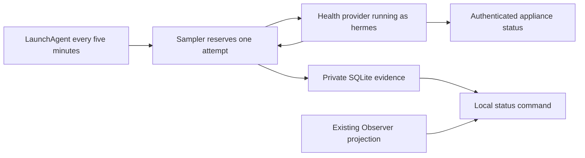

# Firewalla health sampler Operator Guide

This guide is for the owner of the M4 Mac mini. The sampler takes one health sample per five minutes in the logged-in user's launchd domain. It keeps local evidence and can run while AI is unavailable. Its status command also summarizes the existing four-target Homelab Observer cache.

## Access and qualification

Install from the reviewed PR #2 revision. The provider uses the installed Node
24.20.0 and pinned Firewalla client. The sampler uses the installed Homebrew
Python with a working SQLite `hard_heap_limit`.

The credential-owner job is `system/com.nibrwr.firewalla-health-provider`. It
runs as `hermes` and listens on `/var/run/firewalla-health/status.sock`. The
one-shot sampler is `com.nibrwr.firewalla-security-sampler` in the approved
login account's GUI domain. The current system state is in the
[qualification record](SAMPLER-CONTRACT.md).

Enroll the intended physical appliance only after independently confirming the
paired-group reference and LAN IPv4 address. The hidden prompt compares the
address to the existing protected target and keeps only fingerprints in new
provider state. A one-shot authenticated read must then match exactly one cloud
group and exactly one key for that pairing, and decrypt a fresh response from
the pinned LAN target. Use the provider's fixed success result as evidence.
The credential owner retains the existing key files. The provider reuses its
authenticated session between reads. A failed or interrupted login suppresses
another attempt for 15 minutes. A prior verified read permits reauthentication
after five minutes.

The socket allows the designated sampler account to connect through a
per-account ACL. The provider checks the connecting account with Darwin peer
credentials before reading request bytes. The sampler checks the socket inode
owner and the connected provider UID. Both programs are required to qualify the
boundary.

The client sends the following single UTF-8 JSON line, then shuts down its write side.

```json
{"schema_version":1,"operation":"get_network_status"}
```

A successful exchange returns one newline-terminated UTF-8 object and then closes the connection. This example uses fictional values.

```json
{"schema_version":1,"operation":"get_network_status","identity":"verified","timestamp":"2027-01-15T08:00:00Z","uptime":180}
```

The timestamp is UTC in ISO 8601 form. A successful uptime is a nonnegative
number of seconds. The sampler's deadline is ten seconds. The provider's
deadline is nine seconds, covering socket intake and any cloud and LAN work.
All response bodies are capped at 16 KiB before JSON parsing. The provider
returns a fixed error code on failure. Both sides enforce their own persisted
read spacing. The provider makes one encrypted LAN health request for an
eligible sample and no upstream request on rejected socket input. The vendor
LAN protocol protects the payload with the paired key over HTTP. The LAN
transport remains an operator trust boundary.



## Status and incidents

Run `/opt/homebrew/bin/python3 -E -s -B sampler/firewalla-health.py status` from the reviewed checkout, or use the copy in the installed program directory. The command reads status without taking a Firewalla sample. Run it under the intended LaunchAgent account. The schema uses fixed status and incident types, numeric counts, and UTC timestamps. Uptime is exported in whole seconds. The output has no host, group, credential, device, or browsing fields. Unknown health has a reason code. `last_attempt_at` and `last_success_at` distinguish the attempt from Firewalla's last accepted timestamp.

Two failed or absent five-minute intervals open one `telemetry_gap`. A gap inferred by the read-only status command while the sampler is offline has `gap_persisted: false` until the sampler records it. Two consecutive fresh samples close the gap. An uptime decrease records `possible_process_restart`. The upstream ping handler reports process uptime. Observer context is independent and only reports fresh responding and qualified counts. [Firewalla ping handler](https://github.com/firewalla/firewalla/blob/master/controllers/netbot.js#L2401-L2408)

After a crash, the durable attempt prevents replay in the same interval. Once the next eligible invocation runs, interrupted or skipped intervals count toward the gap. A stale read is unknown at ten minutes, even if the most recent stored result was successful. If the Mac sleeps or the user logs out, StartInterval invocations can be missed. The sampler detects them on return. The intended runtime is a logged-in GUI session.

## Storage and resource limits

The owner-only state directory is `~/Library/Application Support/Firewalla Health Sampler/state`. SQLite uses its rollback journal, a capped 8 MiB database, a file-size limit of 12 MiB per file, a 16 MiB SQLite heap limit, and a private exclusive lock. It prunes readings after seven days and normalized incidents after 30 days on collection. The status command returns up to the 100 most recent incident records inside that retention window with `incidents_omitted`. After 100 new incidents per UTC day, `overflow_today` counts suppressed records. A long-running telemetry gap remains active in the summary after its incident record expires.

Only one request is in flight. The sampler waits for the next eligible slot before another read and reserves at most 288 attempts over a trailing day. It allows up to ten seconds of scheduler jitter when an invocation would read just before the five-minute minimum spacing. A storage write failure before reservation prevents a source call. A failed write after the call leaves a pending reservation that is handled as interrupted on restart.

The job discards stdout and stderr, uses no child processes, and applies a one-second soft and two-second hard process CPU limit. The sampler checks peak RSS against 32 MiB. The provider checks peak RSS
against 68 MiB and allows one second of CPU per request. These are process
guards rather than macOS hard RSS limits. The provider's private ledger uses a
small fixed-size record with atomic replacement. It adds no log store. Confirm
combined incremental RSS within 100 MiB, CPU within 1% of one core over a
15-minute window, and combined runtime storage within 32 MiB. Use the owner-only
counts command and sampler status to measure read and login attempts.

## Supervised provider qualification

Use a local terminal on the M4 with the owner present. Start with both proposed
labels absent in the system and intended GUI domains. Check `launchctl
print-disabled` for both domains and check the installation paths below. Stop
if a pre-existing or intentionally disabled installation owns either label.
Record one successful existing Firewalla status read and the four-target
Observer snapshot before setup.

Build a private, unprivileged bundle from the reviewed checkout.

```sh
bundle="$(mktemp -d /private/tmp/firewalla-provider.XXXXXXXX)"
/bin/sh deploy/prepare-health-provider.sh "$bundle"
```

The following steps require local administrator authentication. The
administrator is the logged-in sampler account for these examples. They create
only the new provider installation, private state, and socket directory. Run
each stage from the reviewed checkout and stop on a failed step.

```sh
set -eu
provider_dir=/opt/firewalla-health-provider
provider_state=/var/db/firewalla-health-provider
socket_dir=/var/run/firewalla-health
provider_plist=/Library/LaunchDaemons/com.nibrwr.firewalla-health-provider.plist
sampler_uid="$(id -u)"
sampler_user="$(id -un)"
for path in "$provider_dir" "$provider_state" "$socket_dir" "$provider_plist"; do
    if [ -e "$path" ] || [ -L "$path" ]; then
        printf '%s\n' 'Provider path already exists. Inspect before continuing.'
        exit 1
    fi
done
sudo /bin/mkdir -m 755 "$provider_dir"
for file in attest.py firewalla.mjs main.mjs network.mjs peer.node sdk.mjs socket.mjs state.mjs; do
    sudo /usr/bin/install -o root -g wheel -m 644 "$bundle/$file" "$provider_dir/$file"
done
sudo /bin/mkdir -m 700 "$provider_state" "$socket_dir"
sudo /usr/sbin/chown hermes "$provider_state" "$socket_dir"
sudo /bin/chmod +a "user:$sampler_user allow search" "$socket_dir"
sudo -u hermes /usr/bin/python3 -E -s -B "$provider_dir/attest.py" "$sampler_uid"
sudo -u hermes /opt/hermes-homelab/node/bin/node --max-old-space-size=24 "$provider_dir/main.mjs" verify
```

The final command must return `{"identity":"verified","state":"observed"}`.
A mismatch, failed login, malformed LAN response, timeout, or resource breach
blocks activation. It consumes a read reservation. Wait five minutes before
another eligible query. An unverified login is subject to the longer backoff.
Keep the raw group and address in the hidden prompt.

Once exact identity passes, start `main.mjs serve` as `hermes` under local
supervision. From the sampler account, confirm it can reach the socket through
the existing sampler and that the provider rejects other input. Allow five
minutes between actual health reads. Stop the foreground provider before
loading the installed daemon. Its state lock and ledger survive the change.
After supervised bounds and readback pass, install the exact reviewed manifest
and bootstrap only the provider.

```sh
sudo /usr/bin/install -o root -g wheel -m 644 "$bundle/provider.plist" "$provider_plist"
sudo /bin/launchctl bootstrap system "$provider_plist"
```

## Install the sampler and measure production

Proceed once the provider and permitted local account pass the health exchange.
Confirm the sampler label and paths are unused and its existing fixture gates
pass. Keep the sampler state under its dedicated private program root.

From the reviewed checkout in a local terminal, create a new private program directory and materialize the manifest. A pre-existing directory or manifest requires an operator inspection before reinstallation. The example fails on existing paths.

```sh
set -eu
umask 077
sampler_dir="$HOME/Library/Application Support/Firewalla Health Sampler"
agent="$HOME/Library/LaunchAgents/com.nibrwr.firewalla-security-sampler.plist"
if [ -e "$sampler_dir" ] || [ -L "$sampler_dir" ] || [ -e "$agent" ] || [ -L "$agent" ]; then
    printf '%s\n' 'Sampler program or LaunchAgent path already exists.'
    exit 1
fi
mkdir -m 700 "$sampler_dir"
cp -R sampler "$sampler_dir/program"
/opt/homebrew/bin/python3 -E -s -B - "$sampler_dir/program" "$agent" <<'PY'
import plistlib
import sys

with open("deploy/com.nibrwr.firewalla-security-sampler.plist.in", "rb") as source:
    manifest = plistlib.load(source)
manifest["ProgramArguments"][4] = sys.argv[1] + "/firewalla-health.py"
with open(sys.argv[2], "xb") as target:
    plistlib.dump(manifest, target)
PY
plutil -lint -- "$agent"
launchctl bootstrap "gui/$(id -u)" "$agent"
```

Read back both job labels with `launchctl print` and the sampler status
command. Observe a full 15-minute period with scheduled samples. Compare the
provider's read and login counter deltas and the sampler's durable attempt
count. A controlled restart of the provider must resume the single-read cadence
without replaying an attempt. A sampler restart must preserve SQLite history and
skip any slot already reserved. Recheck the independent Firewalla and Observer
paths and the historical disablements afterwards.

A GUI LaunchAgent samples only while its login session is running. Logout
stops collection and the next eligible invocation records any resulting gap.
The provider is a system daemon, subject to boot readiness and the presence of
its socket directory. Verify those after any host reboot. A controlled job
restart does not establish host reboot recovery.

Use the [Operations Quick Reference](SAMPLER-QUICK-REFERENCE.md) for daily inspection and rollback. Stop activation or roll back the new job on identity or permission drift, an unavailable local provider, repeated resource breaches, or degraded operation of the existing connector or Observer.

## Fixture-only detections

Run `/opt/homebrew/bin/python3 -E -s -B sampler/evaluate-fixtures.py tests/fixtures/held-out.json` for the four additional detectors. The fixture driver uses complete and time-ordered bounded snapshots. An absent, stale, partial or contradictory snapshot produces an unknown result. Alarm comparison uses active high or critical entries and combines event time and temporary fixture references to avoid recounting the same event. Device comparison counts newly observed entries. Rule comparison uses canonical action, enabled state, priority and scope. VLAN comparison uses tags, segment and isolation. Output includes counts and fixed reasons. These detectors have no live inputs or schedule.
