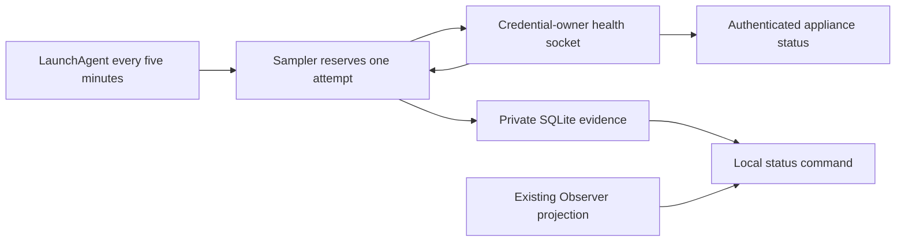

# Firewalla health sampler Operator Guide

This guide is for the owner of the M4 Mac mini. The sampler takes one health sample per five minutes in the logged-in user's launchd domain. It keeps local evidence and can run while AI is unavailable. Its status command also summarizes the existing four-target Homelab Observer cache.

## Access and qualification

Use the reviewed Firewalla sampler revision and the already installed `/opt/homebrew/bin/python3` with Python 3.10+ and a working SQLite `hard_heap_limit`. The proposed LaunchAgent is `com.nibrwr.firewalla-security-sampler`. Its fixed endpoint contract is `/var/run/firewalla-health/status.sock`. The endpoint is an installation prerequisite. The current M4 credential-owner tunnel has a private socket for tunnel supervision and its Firewalla request path is stdio. See the [current qualification record](SAMPLER-CONTRACT.md).

The socket must be owned by the existing Firewalla credential owner, `hermes`, and reachable by the sampler's login account. The sampler checks both the socket inode owner and the connected peer UID. A conforming provider verifies the exact expected paired group against the intended private LAN appliance through protected owner evidence. It uses the existing paired key custody and an existing authenticated session where possible. It returns `identity: "verified"` only after that match and a successful authenticated read. The provider must admit the designated local caller, accept only the fixed request, reject other methods or arguments before dispatch, and make at most one health operation per request. The provider's proof and permissions are a distinct trust boundary from the sampler's peer check.

The client sends the following single UTF-8 JSON line, then shuts down its write side.

```json
{"schema_version":1,"operation":"get_network_status"}
```

A successful exchange returns one newline-terminated UTF-8 object and then closes the connection. This example uses fictional values.

```json
{"schema_version":1,"operation":"get_network_status","identity":"verified","timestamp":"2027-01-15T08:00:00Z","uptime":180}
```

The timestamp is UTC in ISO 8601 form and uptime is a nonnegative number of seconds. The credential owner controls any upstream Firewalla cloud login. The sampler itself makes a Unix socket request. It checks the ten-second deadline and 16 KiB frame limit before accepting JSON. Unverified peer, failed attestation, bad schema, replay, stale or future time, and timeout are reported as unknown. Request delivery and identity qualification are separate checks. The two existing ChatGPT tool results do not qualify this local endpoint.



## Status and incidents

Run `/opt/homebrew/bin/python3 -E -s -B sampler/firewalla-health.py status` from the reviewed checkout, or use the copy in the installed program directory. The command reads status without taking a Firewalla sample. Run it under the intended LaunchAgent account. The schema uses fixed status and incident types, numeric counts, and UTC timestamps. Uptime is exported in whole seconds. The output has no host, group, credential, device, or browsing fields. Unknown health has a reason code. `last_attempt_at` and `last_success_at` distinguish the attempt from Firewalla's last accepted timestamp.

Two failed or absent five-minute intervals open one `telemetry_gap`. A gap inferred by the read-only status command while the sampler is offline has `gap_persisted: false` until the sampler records it. Two consecutive fresh samples close the gap. An uptime decrease records `possible_process_restart`. The upstream ping handler reports process uptime. Observer context is independent and only reports fresh responding and qualified counts. [Firewalla ping handler](https://github.com/firewalla/firewalla/blob/master/controllers/netbot.js#L2401-L2408)

After a crash, the durable attempt prevents replay in the same interval. Once the next eligible invocation runs, interrupted or skipped intervals count toward the gap. A stale read is unknown at ten minutes, even if the most recent stored result was successful. If the Mac sleeps or the user logs out, StartInterval invocations can be missed. The sampler detects them on return. The intended runtime is a logged-in GUI session.

## Storage and resource limits

The owner-only state directory is `~/Library/Application Support/Firewalla Health Sampler/state`. SQLite uses its rollback journal, a capped 8 MiB database, a file-size limit of 12 MiB per file, a 16 MiB SQLite heap limit, and a private exclusive lock. It prunes readings after seven days and normalized incidents after 30 days on collection. The status command returns up to the 100 most recent incident records inside that retention window with `incidents_omitted`. After 100 new incidents per UTC day, `overflow_today` counts suppressed records. A long-running telemetry gap remains active in the summary after its incident record expires.

Only one request is in flight. The sampler waits for the next eligible slot before another read and reserves at most 288 attempts over a trailing day. It allows up to ten seconds of scheduler jitter when an invocation would read just before the five-minute minimum spacing. A storage write failure before reservation prevents a source call. A failed write after the call leaves a pending reservation that is handled as interrupted on restart.

The job discards stdout and stderr, uses no child processes, and applies a one-second soft and two-second hard process CPU limit. It checks peak RSS around collection, bounds the socket frame and SQLite heap, and uses no OS-level hard RSS limit on this Mac. Confirm actual peak RSS within 100 MiB and CPU within 1% of one core over a 15-minute window, including any incremental work in the provider. Check the combined 32 MiB storage limit and actual request count in qualification.

## Install and verify

Proceed only once the owner has attested the exact box and verified the health socket from the intended login account. Use the revision whose fixture, resource, persistence, fault, and regression checks passed. Confirm the job label is absent and the installation paths below belong to this sampler. Record the baseline health of the existing two-tool Firewalla connector and the four-target Observer before changing the new job.

From the reviewed checkout in a local terminal, create a new private program directory and materialize the manifest. A pre-existing directory or manifest requires an operator inspection before reinstallation. The example fails on existing paths.

```sh
set -eu
umask 077
sampler_dir="$HOME/Library/Application Support/Firewalla Health Sampler"
agent="$HOME/Library/LaunchAgents/com.nibrwr.firewalla-security-sampler.plist"
if [ -e "$sampler_dir" ] || [ -L "$sampler_dir" ] || [ -e "$agent" ] || [ -L "$agent" ]; then
    printf '%s\n' 'Sampler program or LaunchAgent path already exists.'
    exit 1
fi
mkdir -m 700 "$sampler_dir"
cp -R sampler "$sampler_dir/program"
/opt/homebrew/bin/python3 -E -s -B - "$sampler_dir/program" "$agent" <<'PY'
import plistlib
import sys

with open("deploy/com.nibrwr.firewalla-security-sampler.plist.in", "rb") as source:
    manifest = plistlib.load(source)
manifest["ProgramArguments"][4] = sys.argv[1] + "/firewalla-health.py"
with open(sys.argv[2], "xb") as target:
    plistlib.dump(manifest, target)
PY
plutil -lint -- "$agent"
launchctl enable "gui/$(id -u)/com.nibrwr.firewalla-security-sampler"
launchctl bootstrap "gui/$(id -u)" "$agent"
```

Read back the named job with `launchctl print "gui/$(id -u)/com.nibrwr.firewalla-security-sampler"` and the status command. Observe at least three five-minute intervals. Confirm time order and query count, verify resources over a 15-minute window, and restart only this job with `launchctl kickstart -k` against that same job identifier. A restart inside a reserved interval should keep the current read count. Verify that health and Observer context advance after the restart. Check the two existing connector tools remain available using their existing admission boundary and use its health operation for the readback. Confirm the historical jobs' disabled state by readback.

Use the [Operations Quick Reference](SAMPLER-QUICK-REFERENCE.md) for daily inspection and rollback. Stop activation or roll back the new job on identity or permission drift, an unavailable local provider, repeated resource breaches, or degraded operation of the existing connector or Observer.

## Fixture-only detections

Run `/opt/homebrew/bin/python3 -E -s -B sampler/evaluate-fixtures.py tests/fixtures/held-out.json` for the four additional detectors. The fixture driver uses complete and time-ordered bounded snapshots. An absent, stale, partial or contradictory snapshot produces an unknown result. Alarm comparison uses active high or critical entries and combines event time and temporary fixture references to avoid recounting the same event. Device comparison counts newly observed entries. Rule comparison uses canonical action, enabled state, priority and scope. VLAN comparison uses tags, segment and isolation. Output includes counts and fixed reasons. These detectors have no live inputs or schedule.
